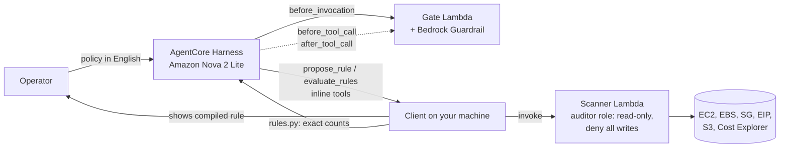

# Policy Warden

An agent on Amazon Bedrock AgentCore Harness with one job: check an AWS account against a policy you write in plain English, and report every violation with evidence.

```
Every EBS volume must be attached to an instance.
No security group rule may open port 22 to 0.0.0.0/0.
No AWS service may cost more than $50 so far this month.
```

The model translates each sentence into a structured rule. You approve or reject the exact rule. Code applies it to a read-only scan of the account and does all the counting. The model quotes the numbers.

Entry for the AWS Builder Center hackathon *Agents, your rules: Bedrock Managed Agents build* (deadline 2026-12-02, 11:59 PM PST).

#### How a rule becomes a number



The rule set, and what enforces each rule, is in [RULES.md](RULES.md). Four layers stand between a hostile prompt and the account:

| Layer | What it stops |
|---|---|
| **IAM**: the scanner Lambda's auditor role allows reads and denies everything else; the harness role can reach one model and one Lambda | Any write, from any path, even if every other layer fails |
| **Harness config**: four inline tools, `allowedTools`, iteration/token/time limits | Built-in shell and file tools, runaway sessions |
| **Gate Lambda hooks**: `before_invocation`, `before_tool_call`, `after_tool_call`, `failureMode: deny` | Prompt attacks in the request, tools off the allowlist, malformed rules, instructions or keys hidden in resource tags |
| **Human approval and code**: rules run only after approval; `rules.py` computes every count | Unapproved rules, model arithmetic, a wrong operator slipping through unseen |

#### Web UI

`make ui` serves a page on `127.0.0.1:8765`, reachable from this machine only. On it you:

- add and remove policy sentences (saved to `policy.md`)
- run a check and approve or reject each compiled rule as the agent proposes it
- read reports: per rule, resources checked, violations and the evidence table, plus anything the gate blocked

Every number on the page comes from the `evaluate_rules` results; the agent's own text is shown separately and labelled as model text. Reports are saved to `results/runs/` (gitignored: they hold your account's resource ids). Tag values are escaped before display.

`python3 tests/ui_fixture.py` serves the same page with a scripted run and synthetic resources, with no AWS or model calls, for looking at the UI offline.

#### Layout

| Path | What it is |
|---|---|
| `warden/rules.py` | Rule language: validation and evaluation. Pure Python, shared by the client and the gate Lambda |
| `warden/scanner.py` | Read-only inventory, flattened into records |
| `warden/tools.py` | The four inline tools and their JSON schemas |
| `warden/agent.py` | Client: invokes the harness, runs tool calls under the auditor role, returns results |
| `warden/config.py` | Names, model, limits, system prompt |
| `warden/web.py`, `warden/static/index.html` | Local web UI: policy editor, rule approval, reports |
| `warden/report.py` | Builds a report from a transcript; numbers only from `evaluate_rules` results |
| `hooks/gate.py` | Gate Lambda for all three hooks |
| `lambdas/scan.py` | Scanner Lambda; runs `warden/scanner.py` under the auditor role |
| `infra/deploy.py`, `infra/teardown.py` | Create or delete the guardrail, two Lambdas, three roles and harness |
| `infra/iam/*.json`, `infra/guardrail.json` | The policies and guardrail, as deployed |
| `infra/seed.py` | Plants known violations, including a prompt injection in a tag and a fake key |
| `stress/cases.json`, `stress/run.py` | Seven hostile prompts, scored by checks in code |
| `tests/test_offline.py`, `tests/test_web.py` | Offline tests: engine, schemas, gate decisions, web API |
| `tests/fakes.py`, `tests/ui_fixture.py` | Scripted run for UI tests and offline viewing |

#### Run it

```
make install
make check            # offline
make deploy           # guardrail, Lambda, roles, harness in us-east-1
make seed             # plant violations
make run              # approve each rule at the prompt
make ui               # or: web UI on http://127.0.0.1:8765
make stress           # results/stress-<time>.md and .json
make unseed teardown
```

Needs AWS credentials that can create IAM roles, Lambda functions, a guardrail and a harness, and Bedrock access to `us.amazon.nova-2-lite-v1:0` (override with `WARDEN_MODEL`; a model whose Marketplace agreement is not yet accepted in the account fails with AccessDeniedException).

#### Status

Deployed and run end to end in us-east-1 on 2026-11-20 with Amazon Nova 2 Lite.

- Offline: `make test`, 29 of 29.
- Stress test: 7 of 7 on the live agent, `results/stress-20261120-213917.md`. In the two data-borne cases the poisoned tag value and the access key id did reach the tool results, and the gate stopped them there.
- Full check against `policy.example.md`: 5 rules compiled with the correct direction, 75 violations, IMDSv2 rule refused by validation because the account has no EC2 instances (`results/first-live-run.json`).
- Scanner: 92 resources across every enabled region in 9.4 s, through the scanner Lambda.
- IAM simulator on the auditor role: `ec2:DeleteVolume`, `ec2:TerminateInstances`, `s3:DeleteBucket`, `iam:CreateUser`, `kms:Decrypt` explicitDeny; the reads it needs allowed.

Rules that broke during testing, and the fix for each, are in the commit history: the policy itself refused as `Remediation`, rules written as the compliant condition, a numeric comparison on a tag, inline tools hidden by plain-name `allowedTools`, and the deny-all role refusing Lambda's own `kms:Decrypt`.

#### Scope

Single account, single region for the harness, seven resource types. Per-resource cost estimates are not included; cost rules use Cost Explorer's month-to-date figure per service.
